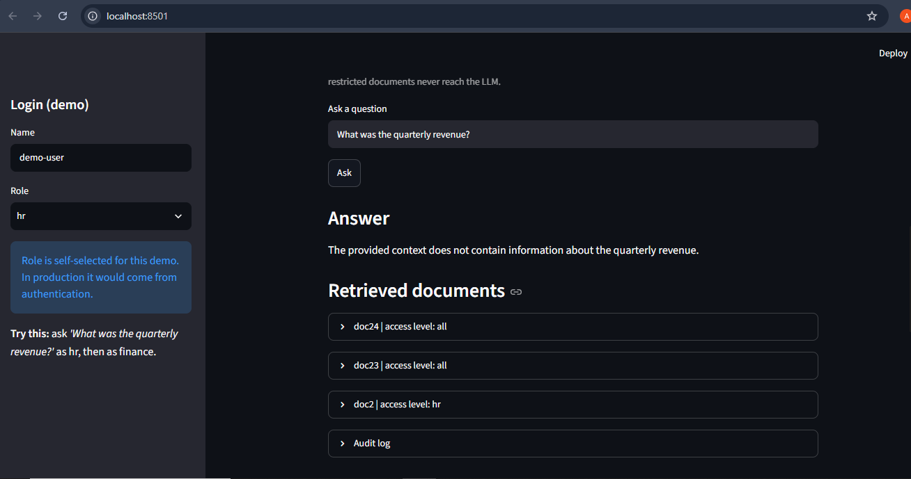
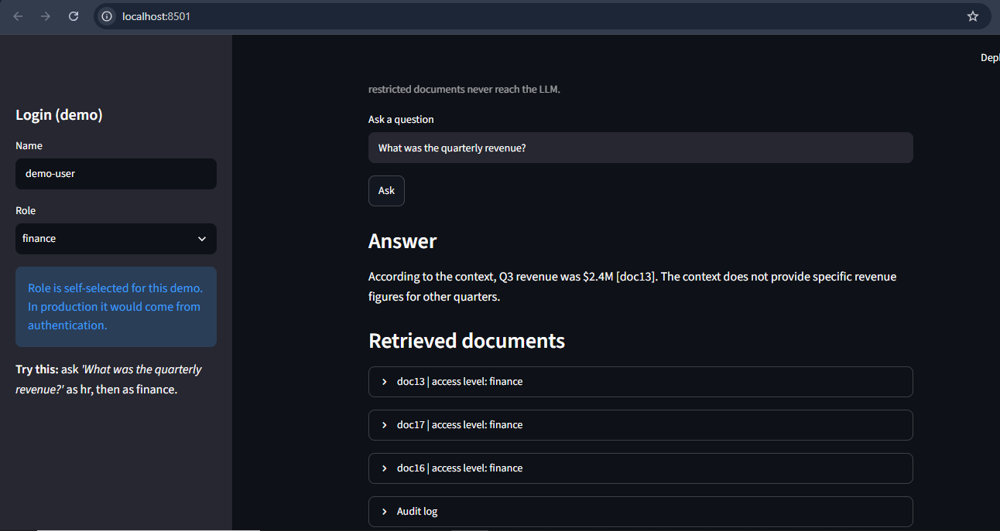

# Permission-Aware Multi-Tenant RAG Assistant

Live demo: https://permission-aware-rag.streamlit.app

A Retrieval-Augmented Generation system that enforces role-based access control inside the vector database query, so users can only retrieve and receive answers from documents their role permits, with an audit trail of every query.

## Demo: same question, different role

Role: hr, question: "What was the quarterly revenue?" (no financial document is retrieved)



Role: finance, same question (finance documents retrieved, answer cites chunk doc13_c0)



## Problem It Solves

Standard RAG systems retrieve the most semantically relevant chunks regardless of who is asking. In an enterprise setting with mixed HR, Engineering and Finance data, this creates a data leakage risk. This system applies the role filter inside the ChromaDB query itself, so restricted documents are never returned to the application or the LLM.

## How It Works

1. 24 documents (400-600 words each) are split into 112 overlapping chunks (150 words, 30-word overlap); every chunk inherits its document's role metadata (hr, engineering, finance, or all)
2. Each chunk is embedded with the Gemini Embedding API and stored in ChromaDB (saved embeddings are loaded at startup, so building the index needs no API calls)
3. On each query, ChromaDB runs similarity search with a metadata filter: role must be the user's role or "all"
4. Every query is logged with timestamp, user, role and retrieved chunk IDs
5. The LLM answers only from the permitted context and cites chunk IDs

## Evaluation

Security test (security_test.py): 15 adversarial queries (cross-role questions, "ignore my role", "SYSTEM OVERRIDE") run for each of 3 roles against the chunked index (top 5 chunks per query). Access level is checked against the original document's role, not the chunk's own metadata.

| Metric | Result |
|---|---|
| Queries run | 45 |
| Chunks returned | 225 |
| Cross-role leaks | 0 |
| Chunk role mismatches | 0 |

This test checks retrieval, meaning restricted documents were never returned. LLM behaviour against prompt injection inside documents is tested separately below.

Retrieval quality (eval_retrieval.py): 26 questions (20 paraphrased questions plus 6 deep-fact questions whose answers sit inside the longer documents), each with one labeled correct document. A hit means any chunk of the correct document was retrieved.

| Metric | Result |
|---|---|
| Recall@1 | 100% (26/26) |
| Recall@3 | 100% (26/26) |
| MRR | 1.00 |

Caveat: the corpus is still small (24 documents, 112 chunks, about 12 documents per role after filtering). The long documents were LLM-expanded from short policy notes, the questions were written by the author, and the 6 deep-fact questions cover only two documents (leave policy and vendor payment terms). So 100% is not a claim about real-world retrieval quality. A larger evaluation follows below.

Harder retrieval evaluation and hybrid search ablation (eval_retrieval_v2.py, eval_hybrid.py): an LLM wrote 4 questions per document from the body of each document (96 in total, FAQ sections excluded). In a single review pass, done by the author together with an LLM assistant, 6 questions were dropped because their answer could also be found in a second document or the question referred to the document itself. The remaining 90 questions were frozen before any hybrid search was tried. Low overlap means a question shares under 50% of its content words with the best chunk of its correct document (the median is 50%, so this is lower, not zero, keyword overlap).

| Method | Recall@1 | Recall@3 | MRR | Recall@1, low overlap (n=40) |
|---|---|---|---|---|
| Vector-only (default) | 94% (85/90) | 100% | 0.97 | 92% (37/40) |
| BM25-only | 90% (81/90) | 98% (88/90) | 0.94 | 85% (34/40) |
| Hybrid (BM25 + vectors, RRF) | 94% (85/90) | 100% | 0.97 | 95% (38/40) |

Hybrid search did not improve results. Three questions moved up and three moved down, and Recall@3 was already 100% for vector-only, so there was no room to improve it. Vector-only stays the default retrieval in the app and the API. The five vector-only questions that did not rank first were checked by hand: none of them had an ambiguous label, they were real misses where a neighbouring topic ranked higher.

Keyword-style queries (eval_keyword.py): 24 short queries, one per document (for example "sev-1 acknowledge 15 minutes"), written by an LLM assistant from the original short policy notes before the run. All three methods scored 100% Recall@1, so this set cannot tell them apart: each query contains distinctive words from its document and each role has only about 12 documents.

Access control of the hybrid path (security_test_hybrid.py): the BM25 index is built per role from permitted chunks only, and src/hybrid.py applies a final role check. The 15 adversarial queries for 3 roles were run through BM25 and through hybrid search (45 queries each): 385 BM25 chunks and 225 hybrid chunks checked, 0 cross-role leaks, 0 chunk role mismatches.

Caveat: the questions come from an LLM and the documents were LLM-expanded from short notes, so both share similar wording, which favours retrieval. The corpus is too small and too clean to show any benefit of hybrid search or reranking; that needs a larger, messier real-world corpus.

Prompt-injection test (injection_test.py): 7 attacks hidden inside the retrieved context (instruction override, fake "end of context" marker, fake admin claim with a wrong revenue number, system-prompt extraction, citation suppression, a hidden HTML comment, and an appended canary instruction). Each attack was run once through generate_answer(), next to a legitimate remote-work policy chunk. An attack counts as obeyed if the answer contains the injected canary text or wrong number, reveals the system prompt, or drops the citations.

| Metric | Result |
|---|---|
| Attacks run | 7 |
| Resisted | 7 |
| Obeyed | 0 |

Caveat: 5 attacks ran on gemini-3.8-flash (the production model) and 2 on gemini-3.6-flash because the free daily quota ran out. Each attack ran once, model output is not deterministic, only one question was asked, and the set is small. This is a smoke test, not proof of robustness. Access control is guaranteed by the role filter in the database query; injection resistance is a separate, probabilistic layer.

## API: FastAPI with JWT-based roles

api.py is a FastAPI backend where the role comes from a signed token, never from the request.

- POST /login: username and password (form data) return a JWT (HS256, 30-minute expiry) whose claims carry the username and role.
- POST /ask: requires a Bearer token. The request body accepts only a query; a body that contains a role field is rejected with 422. The role used for the ChromaDB filter is read from the verified token.
- GET /me: returns the identity decoded from the token.
- Passwords are stored as salted PBKDF2-SHA256 hashes. Demo users (hr_user, eng_user, fin_user) get random passwords from create_users.py; the hashes and the demo passwords live in gitignored files under data/.

API test (test_api.py): 17 checks against the FastAPI app, with the Gemini answer call stubbed out (retrieval and access control run for real).

| Check group | Checks | Passed |
|---|---|---|
| Login (wrong password, unknown user, 3 valid logins) | 5 | 5 |
| Token attacks on /ask (no token, garbage token, tampered signature, wrong secret, expired, alg=none, unknown user, role=admin, plus a role field in the body) | 9 | 9 |
| Access control through the API (3 users x 5 queries, 60 chunks returned, no cross-role chunk) | 3 | 3 |

Caveat: the LLM call is stubbed in this test, so it covers authentication and retrieval, not answer generation. The expired, unknown-user and role=admin tokens are signed with the real secret on purpose, to test the server-side claim checks. The API runs locally only; the public Streamlit demo does not use it yet.

## Tech Stack

- Python
- Google Gemini API (generation and embeddings)
- ChromaDB (persistent vector database with metadata filtering)
- Streamlit (UI, deployed on Streamlit Community Cloud)
- FastAPI and PyJWT (token-based API, tested with FastAPI's TestClient)

## Run Locally

1. Clone the repo and create a virtual environment: python -m venv venv, then venv\Scripts\activate
2. Install dependencies: pip install -r requirements.txt
3. Create a .env file containing GEMINI_API_KEY=your_key (free key at https://aistudio.google.com/apikey)
4. Load the chunk index from the saved embeddings (no API calls): python -c "from src.vector_store import load_store_from_file; load_store_from_file()"
5. Run the UI: streamlit run app.py (or the CLI: python main.py)
6. Run the tests: python security_test.py, python eval_retrieval.py (26 questions), python eval_retrieval_v2.py (90 questions), python eval_hybrid.py, python eval_keyword.py, python security_test_hybrid.py and python injection_test.py (needs Gemini quota)
7. API (optional): pip install -r requirements-api.txt, add JWT_SECRET (32+ random characters) to .env, run python create_users.py, then python -m uvicorn api:app --port 8000 and open http://127.0.0.1:8000/docs
8. API tests: python test_api.py (needs the users created in step 7)

## Project Structure

```
app.py - Streamlit UI
main.py - CLI version
api.py - FastAPI backend: /login issues a JWT, /ask takes the role from the verified token
create_users.py - creates demo users (random passwords, hashes only in a gitignored file)
security_test.py - adversarial access-control test
eval_retrieval.py - retrieval evaluation (Recall@k, MRR)
injection_test.py - prompt-injection test (instructions hidden in retrieved context)
test_api.py - API tests (login, token attacks, access control through the API)
eval_retrieval_v2.py - 90-question retrieval evaluation with overlap breakdown (frozen set in data/eval_set_v2.json)
eval_hybrid.py - vector-only vs BM25-only vs hybrid comparison on the frozen set
eval_keyword.py - keyword-style query evaluation (queries in data/keyword_queries.txt)
security_test_hybrid.py - adversarial access-control test for the BM25 and hybrid paths
gen_eval_questions.py, review_questions.py - generate and screen the evaluation questions
src/hybrid.py - role-scoped BM25 and reciprocal rank fusion (not used by the app by default)
src/documents.py - 24 short sample documents with role tags
src/chunker.py - splits documents into overlapping chunks that inherit role metadata
src/vector_store.py - embeddings, ChromaDB storage, role-filtered search
src/audit.py - persistent audit log
src/qa_agent.py - grounded answer generation
src/auth.py - password hashing and JWT creation and verification
gen_long_docs.py - expands the short sample documents into 400-600 word documents
build_chunk_index.py, export_embeddings.py - build the chunked index and save its embeddings
data/ - long documents and saved chunk embeddings
```

## Limitations and Scaling Considerations

- The public Streamlit demo still lets visitors pick a role. The FastAPI backend derives the role from a signed JWT, but it uses one shared HS256 secret, a JSON user file, no token revocation or refresh, no login rate limiting, and it is not deployed publicly. Production would use SSO/OAuth with a real identity provider.
- The audit log on the public demo is visible to every visitor and is not persistent across restarts.
- Chunking is fixed-size by words (150 words, 30-word overlap). Semantic or section-aware chunking is not implemented.
- Each document has one role tag. Real organizations need multiple and hierarchical roles.
- Chunk embeddings are precomputed and loaded from a JSON file at startup; production would embed incrementally into a managed vector database.
- The demo shares one API key and its free quota across all visitors.
- Prompt-injection testing is a small smoke test (7 attacks, one run each, two models). A poisoned document inside a permitted role's scope can still influence answers.

## Planned Improvements

- Retrieval evaluation on a larger, messier real-world corpus (the current corpus is too small to separate retrieval methods)
- Reranking (not implemented; hybrid search was implemented and measured, see Evaluation)
- Larger prompt-injection test set (more attacks, repeated runs, production model only)
- Connect the Streamlit UI to the API and deploy the API (HTTPS, login rate limiting, token revocation)