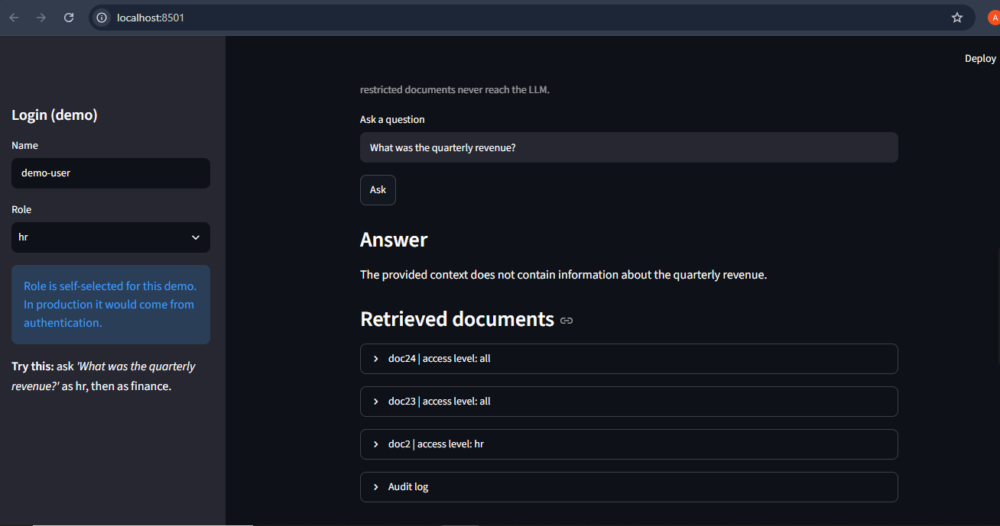
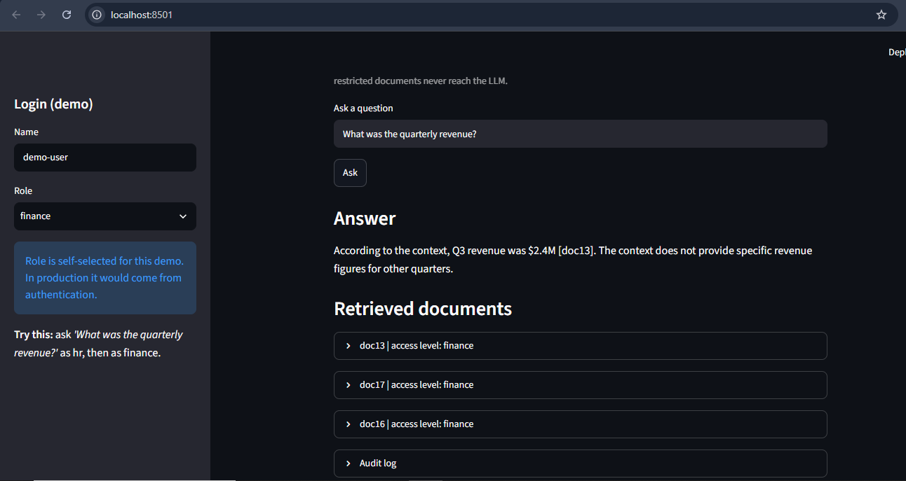

# Permission-Aware Multi-Tenant RAG Assistant

Live demo: https://permission-aware-rag.streamlit.app

A Retrieval-Augmented Generation system that enforces role-based access control inside the vector database query, so users can only retrieve and receive answers from documents their role permits, with an audit trail of every query.

## Demo: same question, different role

Role: hr, question: "What was the quarterly revenue?" (no financial document is retrieved)

Role: finance, same question (finance documents retrieved, answer cites chunk doc13_c0)

## Problem It Solves

Standard RAG systems retrieve the most semantically relevant chunks regardless of who is asking. In an enterprise setting with mixed HR, Engineering and Finance data, this creates a data leakage risk. This system applies the role filter inside the ChromaDB query itself, so restricted documents are never returned to the application or the LLM.

## How It Works

1. 24 documents (400-600 words each) are split into 112 overlapping chunks (150 words, 30-word overlap); every chunk inherits its document's role metadata (hr, engineering, finance, or all)
2. Each chunk is embedded with the Gemini Embedding API and stored in ChromaDB (saved embeddings are loaded at startup, so building the index needs no API calls)
3. On each query, ChromaDB runs similarity search with a metadata filter: role must be the user's role or "all"
4. Every query is logged with timestamp, user, role and retrieved chunk IDs
5. The LLM answers only from the permitted context and cites chunk IDs

## Evaluation

Security test (security_test.py): 15 adversarial queries (cross-role questions, "ignore my role", "SYSTEM OVERRIDE") run for each of 3 roles against the chunked index (top 5 chunks per query). Access level is checked against the original document's role, not the chunk's own metadata.

| Metric | Result |
|---|---|
| Queries run | 45 |
| Chunks returned | 225 |
| Cross-role leaks | 0 |
| Chunk role mismatches | 0 |

This test checks retrieval, meaning restricted documents were never returned. It does not test the LLM's behaviour against prompt injection inside documents.

Retrieval quality (eval_retrieval.py): 26 questions (20 paraphrased questions plus 6 deep-fact questions whose answers sit inside the longer documents), each with one labeled correct document. A hit means any chunk of the correct document was retrieved.

| Metric | Result |
|---|---|
| Recall@1 | 100% (26/26) |
| Recall@3 | 100% (26/26) |
| MRR | 1.00 |

Caveat: the corpus is still small (24 documents, 112 chunks, about 12 documents per role after filtering). The long documents were LLM-expanded from short policy notes, the questions were written by the author, and the 6 deep-fact questions cover only two documents (leave policy and vendor payment terms). So 100% is not a claim about real-world retrieval quality. Harder tests need messier documents, more deep-fact questions and questions with little word overlap.

## Tech Stack

- Python
- Google Gemini API (generation and embeddings)
- ChromaDB (persistent vector database with metadata filtering)
- Streamlit (UI, deployed on Streamlit Community Cloud)

## Run Locally

1. Clone the repo and create a virtual environment: python -m venv venv, then venv\Scripts\activate
2. Install dependencies: pip install -r requirements.txt
3. Create a .env file containing GEMINI_API_KEY=your_key (free key at https://aistudio.google.com/apikey)
4. Load the chunk index from the saved embeddings (no API calls): python -c "from src.vector_store import load_store_from_file; load_store_from_file()"
5. Run the UI: streamlit run app.py (or the CLI: python main.py)
6. Run the tests: python security_test.py and python eval_retrieval.py

## Project Structure

app.py - Streamlit UI
main.py - CLI version
security_test.py - adversarial access-control test
eval_retrieval.py - retrieval evaluation (Recall@k, MRR)
src/documents.py - 24 short sample documents with role tags
src/chunker.py - splits documents into overlapping chunks that inherit role metadata
src/vector_store.py - embeddings, ChromaDB storage, role-filtered search
src/audit.py - persistent audit log
src/qa_agent.py - grounded answer generation
gen_long_docs.py - expands the short sample documents into 400-600 word documents
build_chunk_index.py, export_embeddings.py - build the chunked index and save its embeddings
data/ - long documents and saved chunk embeddings

## Limitations and Scaling Considerations

- Roles are self-selected in the demo. Production would derive roles from real authentication (SSO/OAuth or JWT), never from user input.
- The audit log on the public demo is visible to every visitor and is not persistent across restarts.
- Chunking is fixed-size by words (150 words, 30-word overlap). Semantic or section-aware chunking is not implemented.
- Each document has one role tag. Real organizations need multiple and hierarchical roles.
- Chunk embeddings are precomputed and loaded from a JSON file at startup; production would embed incrementally into a managed vector database.
- The demo shares one API key and its free quota across all visitors.
- No test for prompt injection embedded inside documents.

## Planned Improvements

- Harder retrieval evaluation (more deep-fact questions, questions with low word overlap)
- Hybrid search (BM25 plus vectors) with reranking
- Prompt-injection test set
- FastAPI backend with JWT-based roles